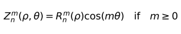
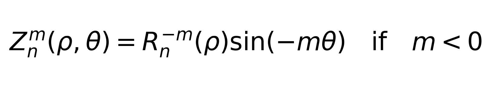
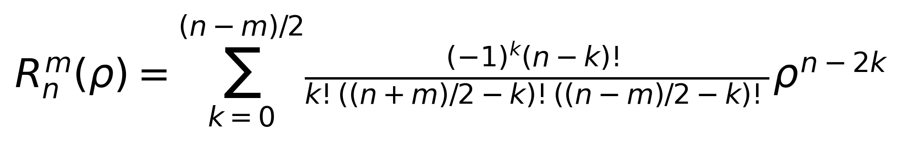
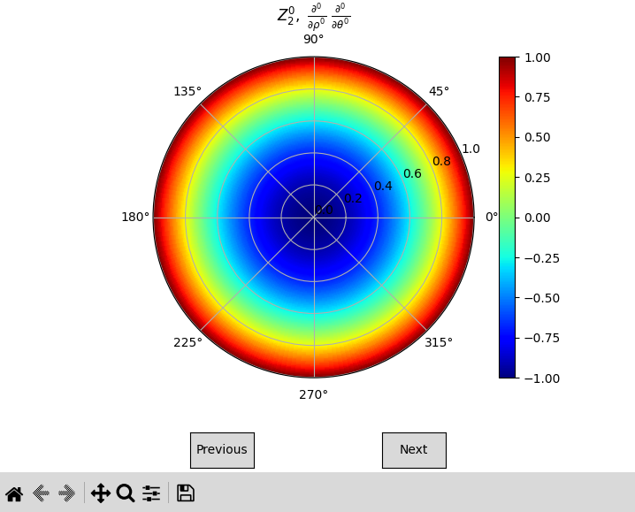

# pyzernike

[](https://pypi.org/project/pyzernike-polynomials/)
[](https://github.com/Artezaru/pyzernike/blob/master/LICENSE)
[](https://Artezaru.github.io/pyzernike)

`pyzernike` computes, fits and displays the Zernike polynomials, on the unit disk and on elliptic annuli
(off-axis pupils, telescopes with a central obscuration, ...), with `numpy` only.

The Zernike polynomials are defined on the unit disk for `|m| <= n` and `n - m` even by:




with:



where `n` is the radial order, `m` is the azimuthal frequency, `ρ` is the normalized radial coordinate (`0 <= ρ <= 1`)
and `θ` is the azimuthal angle.

## Features

- **Polynomials and derivatives of any order**, with exact integer coefficients, in polar coordinates or in Cartesian
  coordinates on an elliptic annulus (shifted, scaled and rotated ellipse with an optional central hole).
- **Accuracy at high orders**: all the polynomials up to an order are computed with a stable recurrence relation.
- **Conventions**: OSA/ANSI, Noll and Fringe indexings, and normalization of Noll.
- **Coefficients**: evaluation of a sum of polynomials and of its derivatives, conversion between the conventions,
  rotation and change of pupil, RMS, peak-to-valley and Strehl ratio.
- **Fitting**: linear least squares fit of sampled data, and residual and Jacobian functions to estimate the
  position and the size of a pupil with any least squares solver.
- **Optional features**: symbolic expressions (`sympy`) and static or interactive figures (`matplotlib`).

All the computations are performed in double precision (`numpy.float64`).

## Installation

```bash
pip install pyzernike-polynomials
```

The optional features need extra dependencies:

```bash
pip install "pyzernike-polynomials[display]"    # matplotlib, for the display functions
pip install "pyzernike-polynomials[symbolic]"   # sympy, for the symbolic expressions
pip install "pyzernike-polynomials[all]"        # all the optional features
```

Or install the development version from GitHub:

```bash
pip install git+https://github.com/Artezaru/pyzernike.git
```

See the [installation guide](https://Artezaru.github.io/pyzernike/installation.html) for more details.

## Quick start

Fit a wavefront sampled on a grid and evaluate its RMS:

```python
import numpy
import pyzernike

x, y = numpy.meshgrid(numpy.linspace(-1, 1, 201), numpy.linspace(-1, 1, 201))
rho, theta = numpy.hypot(x, y), numpy.arctan2(y, x)
wavefront = 0.3 * pyzernike.zernike_polynomial(rho, theta, n=2, m=0)  # NaN outside the unit disk

coefficients = pyzernike.zernike_fit(rho, theta, wavefront, order=4, normalize=True)
print(pyzernike.zernike_rms(coefficients, normalize=True))
```

More examples (wavefront on an elliptic pupil, alignment of a pupil, distortion of a sensor, ...) are available in
the [examples gallery](https://Artezaru.github.io/pyzernike/usage.html).

## Command line

The command `pyzernike` opens an interactive window to explore the polynomials and their derivatives on the unit
disk, and `pyzernike --xy` on an elliptic annulus (`matplotlib` is required):

```bash
pyzernike
pyzernike --xy
```



## Documentation

The [online documentation](https://Artezaru.github.io/pyzernike) contains:

- the [mathematical description](https://Artezaru.github.io/pyzernike/mathematical_description.html) of the
  polynomials, the conventions, the elliptic annulus, the coefficients and the fits;
- the [API reference](https://Artezaru.github.io/pyzernike/api.html) of all the functions;
- the [examples gallery](https://Artezaru.github.io/pyzernike/usage.html).

## Author

- Artezaru <artezaru.github@proton.me>

- **Git platform**: https://github.com/Artezaru/pyzernike
- **Online documentation**: https://Artezaru.github.io/pyzernike

## License

Copyright 2025 Artezaru

Licensed under the Apache License, Version 2.0 (the "License");
you may not use this file except in compliance with the License.
You may obtain a copy of the License at

http://www.apache.org/licenses/LICENSE-2.0

Unless required by applicable law or agreed to in writing, software
distributed under the License is distributed on an "AS IS" BASIS,
WITHOUT WARRANTIES OR CONDITIONS OF ANY KIND, either express or implied.
See the License for the specific language governing permissions and
limitations under the License.