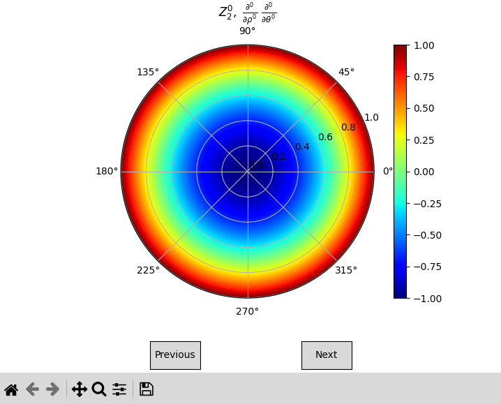

Welcome to pyzernike's documentation!
=========================================================================================

``pyzernike`` computes, fits and displays the Zernike polynomials, on the unit disk and on elliptic annuli
(off-axis pupils, telescopes with a central obscuration, ...), with ``numpy`` only.

The Zernike polynomials are defined on the unit disk for :math:`|m| \leq n` and :math:`n - m` even by:

.. math::

    Z_{n}^{m}(\rho, \theta) = \begin{cases}
        R_{n}^{m}(\rho) \cos(m \theta) & \text{if } m \geq 0 \\
        R_{n}^{|m|}(\rho) \sin(|m| \theta) & \text{if } m < 0
    \end{cases}
    \quad \text{with} \quad
    R_{n}^{m}(\rho) = \sum_{k=0}^{(n-m)/2} \frac{(-1)^k (n-k)!}{k! \left(\frac{n+m}{2} - k\right)! \left(\frac{n-m}{2} - k\right)!} \rho^{n-2k}

where :math:`n` is the radial order, :math:`m` is the azimuthal frequency, :math:`\rho` is the normalized radial
coordinate (:math:`0 \leq \rho \leq 1`) and :math:`\theta` is the azimuthal angle.

Features
--------

- **Polynomials and derivatives of any order**, with exact integer coefficients, in polar coordinates or in Cartesian
  coordinates on an elliptic annulus (shifted, scaled and rotated ellipse with an optional central hole). The
  Cartesian derivatives are exact, also at the center of the pupil.
- **Accuracy at high orders**: all the polynomials up to an order are computed with a stable recurrence relation,
  accurate to the machine precision at any order.
- **Conventions**: OSA/ANSI, Noll and Fringe indexings, and normalization of Noll.
- **Coefficients**: evaluation of a sum of polynomials and of its derivatives, conversion between the conventions,
  rotation and change of pupil (scaling and decentering), RMS, peak-to-valley and Strehl ratio.
- **Fitting**: linear least squares fit of sampled data, and residual and Jacobian functions to estimate the
  position and the size of a pupil with any least squares solver.
- **Optional features**: symbolic expressions (``sympy``) and display in static or interactive figures
  (``matplotlib``).

Quick start
-----------

.. code-block:: bash

    pip install pyzernike-polynomials

Fit a wavefront sampled on a grid and evaluate its RMS:

.. code-block:: python

    import numpy
    import pyzernike

    x, y = numpy.meshgrid(numpy.linspace(-1, 1, 201), numpy.linspace(-1, 1, 201))
    rho, theta = numpy.hypot(x, y), numpy.arctan2(y, x)
    wavefront = 0.3 * pyzernike.zernike_polynomial(rho, theta, n=2, m=0)  # NaN outside the unit disk

    coefficients = pyzernike.zernike_fit(rho, theta, wavefront, order=4, normalize=True)
    print(pyzernike.zernike_rms(coefficients, normalize=True))

Contents
--------

.. grid:: 1 2 2 2
    :gutter: 3

    .. grid-item-card::
      :img-top: /_static/_icons/download.png
      :text-align: center

      Installation
      ^^^

      This section describes how to install the package into a Python environment with ``pip``, and how to
      install the optional dependencies for the display (``matplotlib``) and the symbolic expressions (``sympy``).

      +++

      .. button-ref:: installation
         :expand:
         :color: secondary
         :click-parent:

         To the installation guide

    .. grid-item-card::
      :img-top: /_static/_icons/math.png
      :text-align: center

      Mathematical description
      ^^^

      This section describes the mathematics behind the package: the definitions and the conventions of the
      Zernike polynomials, their computation, their extension to an elliptic annulus, the operations on their
      coefficients and the least squares fits.

      +++

      .. button-ref:: mathematical_description
         :expand:
         :color: secondary
         :click-parent:

         To the mathematical description

    .. grid-item-card::
      :img-top: /_static/_icons/api.png
      :text-align: center

      API Reference
      ^^^

      The reference guide contains a detailed description of the functions included in ``pyzernike``. The
      reference describes how the functions work and which parameters can be used. It assumes that you have an
      understanding of the key concepts.

      +++

      .. button-ref:: api
         :expand:
         :color: secondary
         :click-parent:

         To the API reference

    .. grid-item-card::
      :img-top: /_static/_icons/examples.png
      :text-align: center

      Examples Gallery
      ^^^

      This section contains a collection of examples demonstrating how to use the package for various
      applications (wavefront analysis, alignment of a pupil, distortion of a sensor, ...). Each example includes
      a description of the problem being solved, the code used to solve it, and the resulting output.

      +++

      .. button-ref:: usage
         :expand:
         :color: secondary
         :click-parent:

         To the examples gallery

.. toctree::
   :caption: Contents:
   :hidden:

   installation
   mathematical_description
   api
   usage

Command line
------------

The command ``pyzernike`` opens an interactive window to explore the Zernike polynomials and their derivatives
on the unit disk, and ``pyzernike --xy`` on an elliptic annulus (``matplotlib`` is required):

.. code-block:: bash

    pyzernike
    pyzernike --xy

Author
------

The package ``pyzernike`` was created by the following authors:

- Artezaru <artezaru.github@proton.me>

You can access the package and the documentation with the following URLs:

- **Git platform**: https://github.com/Artezaru/pyzernike
- **Online documentation**: https://Artezaru.github.io/pyzernike

License
-------

The package is distributed under the Apache License 2.0: see the
`LICENSE <https://github.com/Artezaru/pyzernike/blob/main/LICENSE>`_ file of the repository.