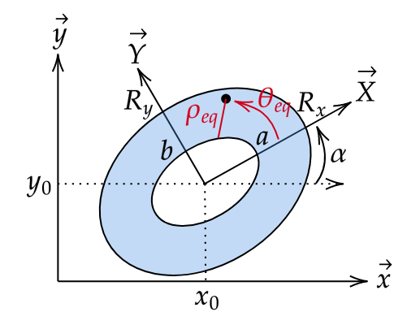

Mathematical description
===============================

.. contents:: Table of Contents
   :local:
   :depth: 2

The Zernike polynomials and their derivatives
-------------------------------------------------

Definition of the Zernike polynomials
~~~~~~~~~~~~~~~~~~~~~~~~~~~~~~~~~~~~~~~~~

The Zernike polynomials :math:`Z_{n}^{m}(\rho, \theta)` are defined on the unit disk :math:`(0 \leq \rho \leq 1, \theta)` as follows:

.. math::

    Z_{n}^{m}(\rho, \theta) = R_{n}^{m}(\rho) \cos(m \theta) \quad \text{if} \quad m \geq 0

.. math::

    Z_{n}^{m}(\rho, \theta) = R_{n}^{-m}(\rho) \sin(-m \theta) \quad \text{if} \quad m < 0

.. note::

    If :math:`|m| > n` or :math:`n < 0`, or :math:`(n - m)` is odd the zernike polynomial is set to zero.

The radial polynomials :math:`R_{n}^{m}(\rho)` are defined as follows:

.. math::

    R_{n}^{m}(\rho) = \sum_{k=0}^{(n-m)/2} \frac{(-1)^k (n-k)!}{k! ((n+m)/2 - k)! ((n-m)/2 - k)!} \rho^{n-2k}

.. note::

    If :math:` m > n`, or :math:`m < 0` or :math:`n < 0`, or :math:`(n - m)` is odd the radial polynomial is set to zero.

The coefficients of the radial polynomial are computed exactly with integer arithmetic (``math.comb``), without forming any factorial,
as a product of two binomial coefficients:

.. math::

    \frac{(n-k)!}{k! ((n+m)/2 - k)! ((n-m)/2 - k)!} = \binom{n-k}{k} \binom{n-2k}{(n-m)/2 - k}

The coefficients are exact and cannot overflow. They are rounded only once, when converted to floating point values,
and the sum is evaluated with the Horner scheme in :math:`\rho^2`.

.. note::

    Even with exact coefficients, the alternating sum suffers from cancellation between its large terms for high orders:
    in double precision, the absolute error stays below :math:`10^{-10}` up to :math:`n \approx 20` for :math:`m = 0`,
    and grows quickly beyond. For high orders, the recurrence relation described below must be preferred.

Derivatives of the Zernike polynomials
~~~~~~~~~~~~~~~~~~~~~~~~~~~~~~~~~~~~~~

The derivative of order (derivative (a)) of the Zernike polynomial with respect to rho and order (derivative (b)) with respect to theta is defined as follows :

.. math::

    \frac{\partial^{a}\partial^{b}Z_{n}^{m}(\rho, \theta)}{\partial \rho^{a} \partial \theta^{b}} = \frac{\partial^{a}R_{n}^{m}(\rho)}{\partial \rho^{a}} \frac{\partial^{b}\cos(m \theta)}{\partial \theta^{b}} \quad \text{if} \quad m > 0

.. math::

    \frac{\partial^{a}\partial^{b}Z_{n}^{m}(\rho, \theta)}{\partial \rho^{a} \partial \theta^{b}} = \frac{\partial^{a}R_{n}^{-m}(\rho)}{\partial \rho^{a}} \frac{\partial^{b}\sin(-m \theta)}{\partial \theta^{b}} \quad \text{if} \quad m < 0

The derivative of order (derivative (a)) of the radial Zernike polynomial is defined as follows :

.. math::

    \frac{d^{a}R_{n}^{m}(\rho)}{d\rho^{a}} = \sum_{k=0}^{(n-m)/2} \frac{(-1)^k (n-k)!}{k! ((n+m)/2 - k)! ((n-m)/2 - k)!} (n-2k) (n-2k-1) \ldots (n-2k-a+1) \rho^{n-2k-a}

The factor :math:`(n-2k) (n-2k-1) \ldots (n-2k-a+1) = \frac{(n-2k)!}{(n-2k-a)!}` is also computed exactly with integer arithmetic (``math.perm``).

Recursive computation of the radial polynomials
~~~~~~~~~~~~~~~~~~~~~~~~~~~~~~~~~~~~~~~~~~~~~~~~~~~~

When all the polynomials up to a radial order :math:`N` are needed, they are computed with the three-term recurrence relation of
Shakibaei and Paramesran [1]_:

.. math::

    R_{n}^{m}(\rho) = \rho \, A_{n}^{m}(\rho) - R_{n-2}^{m}(\rho) \quad \text{with} \quad A_{n}^{m}(\rho) = R_{n-1}^{|m-1|}(\rho) + R_{n-1}^{m+1}(\rho)

for :math:`n \geq 1`, :math:`0 \leq m \leq n` and :math:`(n - m)` even, with the initial condition
:math:`R_{0}^{0}(\rho) = 1` and the convention :math:`R_{n}^{m}(\rho) = 0` whenever :math:`m > n`.
With this convention, the same relation also gives the diagonal terms :math:`R_{n}^{n}(\rho) = \rho^{n}`.

The polynomials are built row by row (one row per radial order :math:`n`), each row only depending on
the rows :math:`n-1` and :math:`n-2`. Each polynomial costs one multiplication and two additions whatever
its order, so that all the polynomials up to the order :math:`N` are computed in :math:`O(N^2)` operations
per point (instead of :math:`O(N^3)` with the explicit sum). The recurrence only combines polynomials
bounded by 1 on :math:`[0, 1]`, so its accuracy stays close to the machine precision at any order.

Differentiating the relation :math:`a` times with the Leibniz rule
:math:`\frac{d^a}{d\rho^a}\left[\rho f(\rho)\right] = \rho f^{(a)}(\rho) + a f^{(a-1)}(\rho)`
gives a recurrence of the same form for the derivatives:

.. math::

    \frac{d^a R_{n}^{m}}{d\rho^a} = \rho \, \frac{d^a A_{n}^{m}}{d\rho^a} + a \, \frac{d^{a-1} A_{n}^{m}}{d\rho^{a-1}} - \frac{d^a R_{n-2}^{m}}{d\rho^a}

with the diagonal terms :math:`\frac{d^a R_{n}^{n}}{d\rho^a} = \frac{n!}{(n-a)!} \rho^{n-a}` and
:math:`\frac{d^a R_{n}^{m}}{d\rho^a} = 0` for :math:`a > n`. The derivative orders :math:`0, 1, \dots, a`
are computed together, since the order :math:`a` requires the order :math:`a - 1`.

.. [1] B. H. Shakibaei and R. Paramesran, "Recursive formula to compute Zernike radial polynomials,"
   Optics Letters 38(14), 2487 (2013). https://doi.org/10.1364/OL.38.002487

Extension of Zernike polynomials to a elliptic annulus domain
------------------------------------------------------------------

Definition of the extended Zernike polynomials
~~~~~~~~~~~~~~~~~~~~~~~~~~~~~~~~~~~~~~~~~~~~~~~~

The Zernike polynomials can be extended to a elliptical annulus domain :math:`G` as follows:

    The parameters to define the extended domain of the Zernike polynomial.

The elliptical domain :math:`G` is defined by the following coefficients:

- :math:`R_x` and :math:`R_y` are the lengths of the semi-axis of the ellipse.
- :math:`x_0` and :math:`y_0` are the coordinates of the center of the ellipse.
- :math:`\alpha` is the rotation angle of the ellipse in radians.
- :math:`h=\frac{a}{R_x}=\frac{b}{R_y}` defining the inner boundary of the ellipse.

The applied mapping is as follows:

.. math::

    Zxy_{n}^{m}(x, y) = Z_{n}^{m}\left(\rho_{eq} = \frac{r - h}{1 - h}, \theta_{eq} = \theta \right)

Where:

.. math::

    r = \sqrt{\left(\frac{X}{R_x}\right)^{2} + \left(\frac{Y}{R_y}\right)^{2}}

.. math::

    \theta = \text{atan2} (\frac{Y}{R_y}, \frac{X}{R_x})

.. math::

    X = \cos(\alpha) (x - x_0) + \sin(\alpha) (y - y_0)

.. math::

    Y = -\sin(\alpha) (x - x_0) + \cos(\alpha) (y - y_0)

For the mathematical development of the method, see Navarro et al. [2]_.

.. [2] R. Navarro et al., "Generalization of Zernike polynomials for regular portions of circles
   and ellipses," Optics Express 22(18), 21263-21279 (2014). https://doi.org/10.1364/OE.22.021263

Derivatives of the extended Zernike polynomials
~~~~~~~~~~~~~~~~~~~~~~~~~~~~~~~~~~~~~~~~~~~~~~~~

The derivatives with respect to x and y can be computed using the chain rule.

.. math::

    \frac{\partial Zxy_{n}^{m}}{\partial z} = \frac{\partial Z_{n}^{m}}{\partial \rho_{eq}} \cdot \frac{\partial \rho_{eq}}{\partial z} + \frac{\partial Z_{n}^{m}}{\partial \theta_{eq}} \cdot \frac{\partial \theta_{eq}}{\partial z}

.. math::

    \frac{\partial^{2} Zxy_{n}^{m}}{\partial \omega \partial z} = \left(\frac{\partial^{2} Z_{n}^{m}}{\partial \rho_{eq}^{2}} \cdot \frac{\partial \rho_{eq}}{\partial \omega} + \frac{\partial^{2} Z_{n}^{m}}{\partial \rho_{eq} \partial \theta_{eq}} \cdot \frac{\partial \theta_{eq}}{\partial \omega}\right) \cdot \frac{\partial \rho_{eq}}{\partial z} + \frac{\partial Z_{n}^{m}}{\partial \rho_{eq}} \cdot \frac{\partial^{2} \rho_{eq}}{\partial \omega \partial z} + \left(\frac{\partial^{2} Z_{n}^{m}}{\partial \theta_{eq} \partial \rho_{eq}} \cdot \frac{\partial \rho_{eq}}{\partial \omega} + \frac{\partial^{2} Z_{n}^{m}}{\partial \theta_{eq}^{2}} \cdot \frac{\partial \theta_{eq}}{\partial \omega}\right) \cdot \frac{\partial \theta_{eq}}{\partial z} + \frac{\partial Z_{n}^{m}}{\partial \theta_{eq}} \cdot \frac{\partial^{2} \theta_{eq}}{\partial \omega \partial z}

where:

.. math::

    \frac{\partial \rho_{eq}}{\partial z} = \frac{1}{1 - h} \cdot \frac{1}{r} \cdot \left( \frac{X}{R_x^2} \cdot \frac{\partial X}{\partial z} + \frac{Y}{R_y^2} \cdot \frac{\partial Y}{\partial z} \right)

.. math::

    \frac{\partial \theta_{eq}}{\partial z} = \frac{1}{R_x R_y} \cdot \frac{1}{r^2} \cdot \left( X \cdot \frac{\partial Y}{\partial z} - Y \cdot \frac{\partial X}{\partial z} \right)

And for the second order derivatives:

.. math::

    \frac{\partial^{2} \rho_{eq}}{\partial \omega \partial z} = \frac{1}{1 - h} \cdot \left\{ \frac{1}{r} \cdot \left( \frac{1}{R_x^2} \frac{\partial X}{\partial \omega} \cdot \frac{\partial X}{\partial z} + \frac{1}{R_y^2} \frac{\partial Y}{\partial \omega} \cdot \frac{\partial Y}{\partial z} \right) - \frac{1}{r^3} \cdot \left( \frac{X}{R_x^2} \cdot \frac{\partial X}{\partial \omega} + \frac{Y}{R_y^2} \cdot \frac{\partial Y}{\partial \omega} \right) \cdot \left( \frac{X}{R_x^2} \cdot \frac{\partial X}{\partial z} + \frac{Y}{R_y^2} \cdot \frac{\partial Y}{\partial z} \right) \right\}

.. math::

    \frac{\partial^{2} \theta_{eq}}{\partial \omega \partial z} = \frac{1}{R_x R_y} \cdot \left\{ \frac{1}{r^2} \cdot \left( \frac{\partial X}{\partial \omega} \cdot \frac{\partial Y}{\partial z} - \frac{\partial Y}{\partial \omega} \cdot \frac{\partial X}{\partial z} \right) - \frac{2}{r^4} \cdot \left( X \cdot \frac{\partial Y}{\partial z} - Y \cdot \frac{\partial X}{\partial z} \right) \cdot \left( \frac{X}{R_x^2} \cdot \frac{\partial X}{\partial \omega} + \frac{Y}{R_y^2} \cdot \frac{\partial Y}{\partial \omega} \right) \right\}