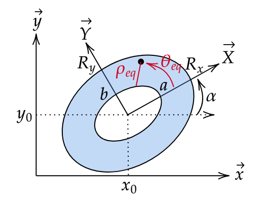

Extension to an elliptic annulus
================================

.. contents:: Table of Contents
   :local:
   :depth: 2

Definition
----------

The Zernike polynomials can be extended to an elliptic annulus domain :math:`G` as follows:

    The parameters to define the extended domain of the Zernike polynomial.

The elliptic annulus domain :math:`G` is defined by the following coefficients:

- :math:`R_x` and :math:`R_y` are the lengths of the semi-axis of the ellipse.
- :math:`x_0` and :math:`y_0` are the coordinates of the center of the ellipse.
- :math:`\alpha` is the rotation angle of the ellipse in radians.
- :math:`h=\frac{a}{R_x}=\frac{b}{R_y}` defining the inner boundary of the ellipse.

The applied mapping is as follows:

.. math::

    Zxy_{n}^{m}(x, y) = Z_{n}^{m}\left(\rho_{eq} = \frac{r - h}{1 - h}, \theta_{eq} = \theta \right)

Where:

.. math::

    r = \sqrt{\left(\frac{X}{R_x}\right)^{2} + \left(\frac{Y}{R_y}\right)^{2}}

.. math::

    \theta = \text{atan2} (\frac{Y}{R_y}, \frac{X}{R_x})

.. math::

    X = \cos(\alpha) (x - x_0) + \sin(\alpha) (y - y_0)

.. math::

    Y = -\sin(\alpha) (x - x_0) + \cos(\alpha) (y - y_0)

The mapping is a diffeomorphism from the unit disk onto the annulus, so the polynomials :math:`Zxy_{n}^{m}` form a
complete basis of the functions on the annulus [Navarro2014]_. For a full ellipse (:math:`h = 0`), the mapping is affine
and the polynomials stay orthogonal for the area of the ellipse; for :math:`h > 0`, they are orthogonal for a weight
that is not uniform (see :doc:`fitting`).

The equivalent coordinates are given by :func:`pyzernike.cartesian_to_elliptic_annulus`, and the polynomials by
:func:`pyzernike.xy_zernike_polynomial` and :func:`pyzernike.xy_zernike_polynomial_up_to_order`.

Cartesian derivatives
---------------------

**Why not the chain rule.** The derivatives with respect to :math:`x` and :math:`y` could be obtained with the chain
rule in :math:`(\rho_{eq}, \theta_{eq})` (see :ref:`polar-coordinates-derivatives`). But the polar coordinates are singular at the
center of the ellipse (:math:`r = 0`): :math:`\theta_{eq}` is not differentiable there, and the chain rule gives
``nan``, although the derivatives of :math:`Zxy_{n}^{m}` exist. Indeed, with :math:`u = X / R_x` and :math:`v = Y / R_y`,
the radial polynomial is :math:`R_{n}^{|m|}(r) = r^{|m|} P(r^2)` with :math:`P` a polynomial, and
:math:`r^{|m|} \cos(|m| \theta) = \operatorname{Re}\left((u + iv)^{|m|}\right)`, so that for :math:`h = 0`:

.. math::

    Zxy_{n}^{m} = P(u^2 + v^2) \cdot \begin{cases}
        \operatorname{Re}\left((u + iv)^{|m|}\right) & \text{if } m \geq 0 \\
        \operatorname{Im}\left((u + iv)^{|m|}\right) & \text{if } m < 0
    \end{cases}

is a polynomial in :math:`(u, v)`, smooth everywhere. The derivatives are therefore computed directly in Cartesian
coordinates, at any order, as follows.

**1. From (x, y) to (u, v).** The map :math:`(x, y) \mapsto (u, v)` is affine, so the derivation operators have
constant coefficients:

.. math::

    \frac{\partial}{\partial x} = \frac{\cos\alpha}{R_x} \frac{\partial}{\partial u} - \frac{\sin\alpha}{R_y} \frac{\partial}{\partial v}
    \quad \text{and} \quad
    \frac{\partial}{\partial y} = \frac{\sin\alpha}{R_x} \frac{\partial}{\partial u} + \frac{\cos\alpha}{R_y} \frac{\partial}{\partial v}

They commute, and :math:`\frac{\partial^{d_x + d_y}}{\partial x^{d_x} \partial y^{d_y}}` is expanded with the binomial formula
into a sum of operators :math:`\frac{\partial^{d_u + d_v}}{\partial u^{d_u} \partial v^{d_v}}` with :math:`d_u + d_v = d_x + d_y`.

**2. Derivation rules in (u, v).** With :math:`r = \sqrt{u^2 + v^2}` and :math:`\theta = \operatorname{atan2}(v, u)`:

.. math::

    \frac{\partial}{\partial u} = \cos\theta \, \frac{\partial}{\partial r} - \frac{\sin\theta}{r} \frac{\partial}{\partial \theta}
    \quad \text{and} \quad
    \frac{\partial}{\partial v} = \sin\theta \, \frac{\partial}{\partial r} + \frac{\cos\theta}{r} \frac{\partial}{\partial \theta}

Applied to a term :math:`A(r) \cos(k\theta)` or :math:`A(r) \sin(k\theta)` and after linearization of the products of
trigonometric functions, with :math:`P = A' + \frac{k}{r} A` and :math:`M = A' - \frac{k}{r} A` (:math:`A' = \frac{dA}{dr}`):

.. math::

    \frac{\partial}{\partial u} [A \cos k\theta] = \tfrac{1}{2} \left[ P \cos(k-1)\theta + M \cos(k+1)\theta \right]
    \quad \text{and} \quad
    \frac{\partial}{\partial v} [A \cos k\theta] = \tfrac{1}{2} \left[ M \sin(k+1)\theta - P \sin(k-1)\theta \right]

.. math::

    \frac{\partial}{\partial u} [A \sin k\theta] = \tfrac{1}{2} \left[ M \sin(k+1)\theta + P \sin(k-1)\theta \right]
    \quad \text{and} \quad
    \frac{\partial}{\partial v} [A \sin k\theta] = \tfrac{1}{2} \left[ P \cos(k-1)\theta - M \cos(k+1)\theta \right]

with :math:`\cos(-\theta) = \cos(\theta)` and :math:`\sin(-\theta) = -\sin(\theta)` when :math:`k = 0`. The result has
the same form, so the rules are applied again for the higher orders.

**3. Exact symbolic computation.** The radial parts are written in the basis :math:`s^{d-q} \rho_{eq}^{p} r^{-q}`, where
:math:`s = \frac{1}{1-h} = \frac{d\rho_{eq}}{dr}` and :math:`d` is the total order of derivation. In this basis:

.. math::

    \frac{d}{dr} \left( s^{d-q} \rho_{eq}^{p} r^{-q} \right) = p \, s^{(d+1)-q} \rho_{eq}^{p-1} r^{-q} - q \, s^{(d+1)-(q+1)} \rho_{eq}^{p} r^{-(q+1)}
    \quad \text{and} \quad
    \frac{1}{r} s^{d-q} \rho_{eq}^{p} r^{-q} = s^{(d+1)-(q+1)} \rho_{eq}^{p} r^{-(q+1)}

so that, starting from the exact integer coefficients of :math:`R_{n}^{|m|}`, all the derivatives are sums of terms
:math:`c \, s^{d-q} \rho_{eq}^{p} r^{-q} \cos(k\theta)` (or :math:`\sin`) with **exact integer coefficients** :math:`c`
which do not depend on the parameters of the annulus. They are computed once and cached, and :math:`h`,
:math:`R_x`, :math:`R_y` and :math:`\alpha` only appear at the numerical evaluation.

**4. Full ellipse (h = 0).** Then :math:`\rho_{eq} = r` and :math:`s = 1`, so :math:`\rho_{eq}^{p} r^{-q} = r^{p-q}`. The terms with
the same exponent :math:`p - q` are merged with integer arithmetic, and the negative powers of :math:`r` cancel exactly:
the result is a polynomial in :math:`(u, v)`, which is exact at the center of the ellipse. This is the constructive
form of the classical result of Noll [Noll1976]_: the Cartesian derivatives of a Zernike polynomial are linear combinations
of Zernike polynomials of lower orders.

**5. Elliptic annulus (h > 0).** The terms :math:`r^{-q}` are evaluated as they are, with
:math:`r = h + (1 - h) \rho_{eq}`. There is no singularity, since :math:`r \geq h > 0` on the annulus (the center of
the ellipse is outside the domain).

The terms are finally evaluated with the Horner scheme in :math:`1/r`, whose coefficients are polynomials in
:math:`\rho_{eq}` evaluated with the Horner scheme in :math:`\rho_{eq}^2`.

.. note::

    As for the radial polynomials, the evaluation of the explicit sums suffers from cancellation for high orders: in
    double precision, the accuracy degrades beyond :math:`n \approx 20`. The recursive mode below avoids it.

Recursive mode
--------------

With ``use_recursive=True`` (:func:`pyzernike.xy_zernike_polynomial_up_to_order`), the exact coefficients of the
derivatives are kept, but they are applied to values computed with the recurrence relation (see :doc:`polynomials`)
instead of powers of :math:`\rho_{eq}`, so that the accuracy stays close to the machine precision at high orders.

**Full ellipse (h = 0).** The derivatives of a Zernike polynomial are polynomials of lower degree in :math:`(u, v)`, so
they are exactly linear combinations of Zernike polynomials of lower orders [Noll1976]_:

.. math::

    \frac{\partial^{d_x + d_y} Zxy_j}{\partial x^{d_x} \partial y^{d_y}} = \sum_{k} C_{jk} \, Zxy_k

The matrix :math:`C` is computed once for each derivative and each ellipse: each derivative in :math:`(u, v)` is
written as a polynomial in :math:`(u, v)` (merged terms of the previous section), and projected onto the Zernike
polynomials with exact rational arithmetic (``fractions.Fraction``). The polynomials :math:`Zxy_k` are then computed
with the recurrence relation, and the derivatives are obtained by a matrix product. There is no singularity at the
center of the ellipse.

**Elliptic annulus (h > 0).** The derivatives are sums of terms
:math:`c \, s^{a} \frac{d^{a} R_{n}^{|m|}}{d\rho^{a}}(\rho_{eq}) \, r^{-q} \cos(k\theta)` (or :math:`\sin`) with exact
integer coefficients :math:`c`: the derivatives of the radial polynomial are computed with the recurrence relation
instead of being expanded in powers of :math:`\rho_{eq}`, and :math:`r \geq h > 0` on the annulus.

In both cases, the values combined by the exact coefficients are bounded and accurate, so the accuracy only degrades
polynomially with the order, instead of exponentially with the explicit sums.

Derivatives with respect to the parameters of the annulus
---------------------------------------------------------

To refine the domain :math:`G` (see :func:`pyzernike.xy_zernike_parameter_derivative`), the first order derivatives of :math:`Zxy_{n}^{m}(x, y)` with respect to the parameters
:math:`(x_0, y_0, R_x, R_y, \alpha, h)` of the annulus are computed at fixed :math:`(x, y)`. The polynomial depends on
:math:`(x_0, y_0, R_x, R_y, \alpha)` only through :math:`(u, v)`, with
:math:`\frac{\partial X}{\partial x_0} = -\cos\alpha`, :math:`\frac{\partial Y}{\partial x_0} = \sin\alpha`,
:math:`\frac{\partial X}{\partial y_0} = -\sin\alpha`, :math:`\frac{\partial Y}{\partial y_0} = -\cos\alpha`,
:math:`\frac{\partial X}{\partial \alpha} = Y` and :math:`\frac{\partial Y}{\partial \alpha} = -X`. With
:math:`Z_u = \frac{\partial Zxy_{n}^{m}}{\partial u}` and :math:`Z_v = \frac{\partial Zxy_{n}^{m}}{\partial v}`
(computed as above, without singularity):

.. math::

    \frac{\partial Zxy_{n}^{m}}{\partial x_0} = -\frac{\cos\alpha}{R_x} Z_u + \frac{\sin\alpha}{R_y} Z_v
    \quad \text{and} \quad
    \frac{\partial Zxy_{n}^{m}}{\partial y_0} = -\frac{\sin\alpha}{R_x} Z_u - \frac{\cos\alpha}{R_y} Z_v

.. math::

    \frac{\partial Zxy_{n}^{m}}{\partial R_x} = -\frac{u}{R_x} Z_u
    \quad \text{,} \quad
    \frac{\partial Zxy_{n}^{m}}{\partial R_y} = -\frac{v}{R_y} Z_v
    \quad \text{and} \quad
    \frac{\partial Zxy_{n}^{m}}{\partial \alpha} = \frac{R_y}{R_x} v Z_u - \frac{R_x}{R_y} u Z_v

The parameter :math:`h` only appears in :math:`\rho_{eq} = \frac{r - h}{1 - h}`, and
:math:`\frac{\partial \rho_{eq}}{\partial h} = \frac{\rho_{eq} - 1}{1 - h}` at fixed :math:`(u, v)`, so:

.. math::

    \frac{\partial Zxy_{n}^{m}}{\partial h} = \frac{\rho_{eq} - 1}{1 - h} \, \frac{\partial Z_{n}^{m}}{\partial \rho}(\rho_{eq}, \theta_{eq})

.. note::

    These derivatives are those of the values at fixed points inside the annulus. The domain itself depends on the
    parameters: when they change, points may enter or leave the annulus, which is not differentiable. Their use to
    estimate the parameters of the annulus is described in :doc:`fitting`.

.. _polar-coordinates-derivatives:

Derivatives of the equivalent polar coordinates
-----------------------------------------------

The derivatives of :math:`(\rho_{eq}, \theta_{eq})` with respect to :math:`z, \omega \in \{x, y\}` are given by the
function :func:`pyzernike.cartesian_to_elliptic_annulus`. They are not used to compute the derivatives of the
extended Zernike polynomials, and they are not defined at the center of the ellipse (:math:`r = 0`). For the first order:

.. math::

    \frac{\partial \rho_{eq}}{\partial z} = \frac{1}{1 - h} \cdot \frac{1}{r} \cdot \left( \frac{X}{R_x^2} \cdot \frac{\partial X}{\partial z} + \frac{Y}{R_y^2} \cdot \frac{\partial Y}{\partial z} \right)

.. math::

    \frac{\partial \theta_{eq}}{\partial z} = \frac{1}{R_x R_y} \cdot \frac{1}{r^2} \cdot \left( X \cdot \frac{\partial Y}{\partial z} - Y \cdot \frac{\partial X}{\partial z} \right)

And for the second order:

.. math::

    \frac{\partial^{2} \rho_{eq}}{\partial \omega \partial z} = \frac{1}{1 - h} \cdot \left\{ \frac{1}{r} \cdot \left( \frac{1}{R_x^2} \frac{\partial X}{\partial \omega} \cdot \frac{\partial X}{\partial z} + \frac{1}{R_y^2} \frac{\partial Y}{\partial \omega} \cdot \frac{\partial Y}{\partial z} \right) - \frac{1}{r^3} \cdot \left( \frac{X}{R_x^2} \cdot \frac{\partial X}{\partial \omega} + \frac{Y}{R_y^2} \cdot \frac{\partial Y}{\partial \omega} \right) \cdot \left( \frac{X}{R_x^2} \cdot \frac{\partial X}{\partial z} + \frac{Y}{R_y^2} \cdot \frac{\partial Y}{\partial z} \right) \right\}

.. math::

    \frac{\partial^{2} \theta_{eq}}{\partial \omega \partial z} = \frac{1}{R_x R_y} \cdot \left\{ \frac{1}{r^2} \cdot \left( \frac{\partial X}{\partial \omega} \cdot \frac{\partial Y}{\partial z} - \frac{\partial Y}{\partial \omega} \cdot \frac{\partial X}{\partial z} \right) - \frac{2}{r^4} \cdot \left( X \cdot \frac{\partial Y}{\partial z} - Y \cdot \frac{\partial X}{\partial z} \right) \cdot \left( \frac{X}{R_x^2} \cdot \frac{\partial X}{\partial \omega} + \frac{Y}{R_y^2} \cdot \frac{\partial Y}{\partial \omega} \right) \right\}

The derivatives of total order 3 and more are not available in :func:`pyzernike.cartesian_to_elliptic_annulus`. They are
not needed for the derivatives of the Zernike polynomials, which are computed without the chain rule (see the section
*Cartesian derivatives* above).