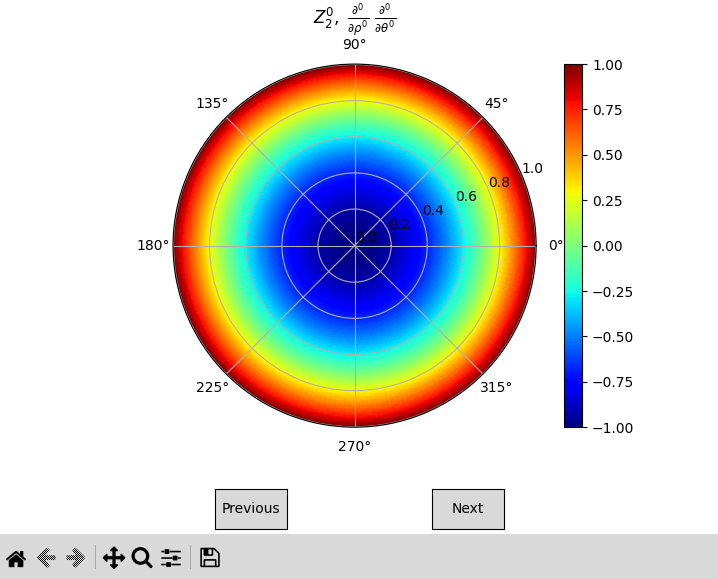

Usage
==============

.. contents:: Table of Contents
   :local:
   :depth: 1
   :backlinks: top

This section shows the main functions of ``pyzernike`` in a few lines each. The details of the parameters are given
in the :doc:`api`, and the methods in the :doc:`mathematical_description`.

Gallery Examples
----------------

The following examples show complete applications of ``pyzernike``, with their code and their results.

.. include:: /_gallery/index.rst
   :start-after: _gallery:
   

Compute Zernike polynomials
---------------------------

Give the orders :math:`(n, m)` and, optionally, the orders of the derivatives. Integers give an array with the shape
of ``rho``, sequences give a list of arrays (the integers are repeated to the length of the sequences):

.. code-block:: python

    import numpy
    from pyzernike import zernike_polynomial

    rho, theta = numpy.meshgrid(numpy.linspace(0, 1, 100), numpy.linspace(0, 2 * numpy.pi, 100))

    Z31 = zernike_polynomial(rho, theta, n=3, m=1)  # array of shape (100, 100)
    Z, dZ_drho, dZ_dtheta = zernike_polynomial(rho, theta, n=2, m=2, rho_derivative=[0, 1, 0], theta_derivative=[0, 0, 1])

All the polynomials up to an order are computed at once in the OSA/ANSI ordering. For high orders, use
``use_recursive=True`` (stable recurrence relation):

.. code-block:: python

    from pyzernike import zernike_polynomial_up_to_order, zernike_order_to_index

    Z = zernike_polynomial_up_to_order(rho, theta, order=40, use_recursive=True, to_list=False)  # shape (1, 861, 100, 100)
    Z20 = Z[0, zernike_order_to_index(2, 0)]

The points outside the unit disk are set to ``default`` (``numpy.nan``), and ``normalize=True`` gives the polynomials
normalized by the factors of Noll. The indices can be converted between the OSA/ANSI, Noll and Fringe conventions with
:func:`pyzernike.zernike_index_to_order` and :func:`pyzernike.zernike_order_to_index`.

On an elliptic annulus
----------------------

The functions prefixed by ``xy_`` work in Cartesian coordinates on an elliptic annulus of semi-axes ``Rx`` and ``Ry``,
center ``(x0, y0)``, rotation ``alpha`` and inner ratio ``h`` (a disk of radius 1 by default). The derivatives of any
order with respect to :math:`x` and :math:`y` are exact, also at the center:

.. code-block:: python

    from pyzernike import xy_zernike_polynomial

    X, Y = numpy.meshgrid(numpy.linspace(-2, 2, 200), numpy.linspace(-2, 2, 200))
    pupil = dict(Rx=2.0, Ry=1.5, alpha=0.3, h=0.2)

    Z31 = xy_zernike_polynomial(X, Y, n=3, m=1, **pupil)  # NaN outside the annulus
    dZ_dx, dZ_dy = xy_zernike_polynomial(X, Y, n=3, m=1, x_derivative=[1, 0], y_derivative=[0, 1], **pupil)

:func:`pyzernike.xy_zernike_polynomial_up_to_order` computes all the polynomials up to an order, and
:func:`pyzernike.cartesian_to_elliptic_annulus` gives the equivalent polar coordinates of the points.

Work with coefficients
----------------------

A vector of coefficients contains all the polynomials up to an order in the OSA/ANSI ordering (1, 3, 6, 10, 15, ...
values). Fit sampled data, evaluate the fitted function and its slopes, and compute its RMS:

.. code-block:: python

    from pyzernike import xy_zernike_fit, xy_zernike_evaluate, zernike_rms

    wavefront = 0.3 * xy_zernike_polynomial(X, Y, n=2, m=0, **pupil)  # measured data, NaN outside the pupil

    coefficients = xy_zernike_fit(X, Y, wavefront, order=4, **pupil)  # 15 coefficients
    fitted = xy_zernike_evaluate(coefficients, X, Y, **pupil)
    dW_dx, dW_dy = xy_zernike_evaluate(coefficients, X, Y, x_derivative=[1, 0], y_derivative=[0, 1], **pupil)
    print(zernike_rms(coefficients))

The coefficients can be converted between conventions (:func:`pyzernike.zernike_coefficients_convert`), expressed in a
rotated or smaller pupil (:func:`pyzernike.zernike_coefficients_rotate`, :func:`pyzernike.zernike_coefficients_transform`),
and give the peak-to-valley and the Strehl ratio (:func:`pyzernike.zernike_peak_to_valley`,
:func:`pyzernike.zernike_strehl_ratio`). The position and the size of a pupil can be estimated with any least squares
solver from the functions of :func:`pyzernike.xy_zernike_least_squares`.

Symbolic expressions
--------------------

With ``sympy`` installed, the exact expressions are given in the symbols ``r`` (:math:`\rho`) and ``t`` (:math:`\theta`):

.. code-block:: python

    from pyzernike import zernike_symbolic

    print(zernike_symbolic(n=3, m=1))  # (3*r**3 - 2*r)*cos(t)

Display
-------

With ``matplotlib`` installed, :func:`pyzernike.zernike_display` and :func:`pyzernike.xy_zernike_display` draw the given
polynomials (the "Previous" and "Next" buttons navigate through them):

.. code-block:: python

    from pyzernike import zernike_display

    zernike_display(n=[0, 1, 1, 2, 2], m=[0, 1, -1, 2, -2])

The interactive windows, where the polynomial, its derivatives and the domain are chosen directly, are opened with
:func:`pyzernike.display_interactive` and :func:`pyzernike.xy_display_interactive`, or from the command line:

.. code-block:: console

    pyzernike         # unit disk
    pyzernike --xy    # elliptic annulus

